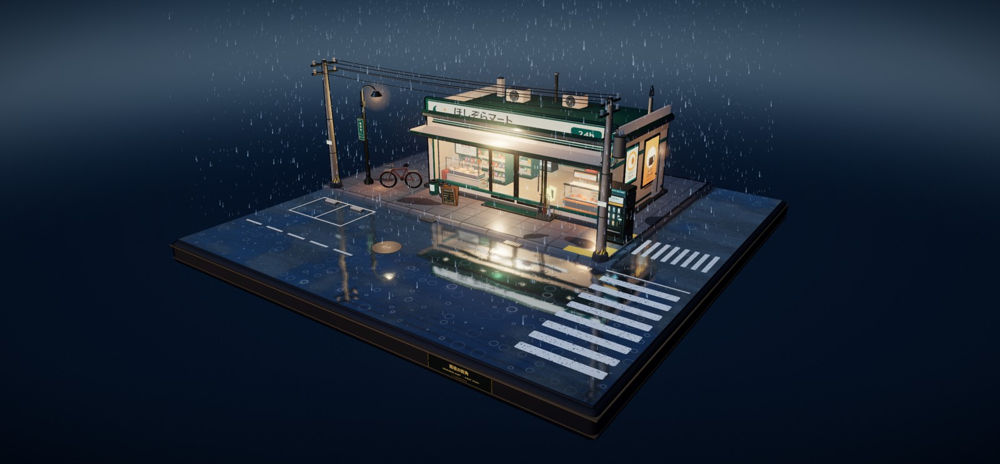
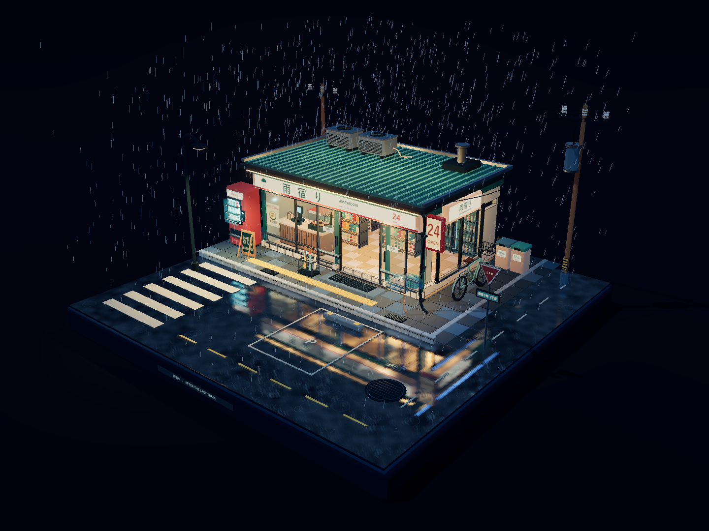

# 雨夜便利店 · Two Builds

同一份创作简报，两套独立的 Three.js 程序化实现。

两套场景都把便利店放在完整的正方形微缩底座上：室外是深蓝雨夜，室内是暖色荧光；玻璃橱窗、自动门、货架、饮料柜、收银台、关东煮柜、自动贩卖机、自行车、雨伞架、垃圾桶、路灯、电线杆、斑马线、停车位和积水一应俱全。雨、屋檐滴水、水洼涟漪、湿路面实时倒影、自动门周期开合与招牌微闪持续运行。

没有 Blender，没有预制三维模型。几何、材质、灯光和动画全部由 JavaScript 生成；CanvasTexture 只用于文字、招牌和商品海报。两套实现不共享代码。

| Route A · 单文件 / CDN | Route B · 离线打包 / 合并几何 |
|:---:|:---:|
| [](qoder-threejs/) | [](codex-threejs/) |
| [进入 Route A](qoder-threejs/) | [进入 Route B](codex-threejs/) |

## 两条技术路线

| 维度 | Route A · Qoder | Route B · Codex |
| --- | --- | --- |
| 交付形态 | 单文件 `index.html`，ES module import map | 内嵌 Three.js 的离线单文件 + 可编辑源码 + esbuild 构建 |
| Three.js 来源 | jsDelivr CDN，r170 | 本地 npm 安装后打包进 HTML，r170 |
| 卡通描边 | 反向外壳 `ShaderMaterial`（BackSide） | `EdgesGeometry` 合并成单个 `LineSegments` |
| 三渲二 | 4 级 `DataTexture` 渐变 + `MeshToonMaterial` | 4 级 `DataTexture` 渐变 + `MeshToonMaterial` |
| 湿地反射 | `Reflector` 1024 + 自写 fbm 水洼遮罩、时间扰动与程序化雨环 | `Reflector` 1024 + 自写湿润遮罩与水面 UV 扰动 |
| 雨 | 两层 GPU Points：4,200 + 900 | 1,450 条 GPU LineSegments + 68 条屋檐滴水 |
| 几何组织 | 常规 Mesh + `InstancedMesh` | 静态几何按材质合并，建筑线条合并 |
| 运行条件 | 需联网加载 CDN；也可用本地服务器 | 双击 HTML 即可，完全离线 |
| 验证记录 | Edge 实拍、无控制台错误、完整底座、自动门周期 | 离线无外部请求、门体断言、完整底座、36.9 fps（1440×1080，Intel UHD） |

两套场景都支持左键拖拽旋转、滚轮缩放、右键拖拽平移；触屏为单指旋转、双指缩放和平移。画面内不显示操作面板。

## 快速运行

### Route A · 单文件 / CDN

```bash
cd qoder-threejs
python -m http.server 4318
```

打开 `http://127.0.0.1:4318/`。也可以直接双击 `index.html`，但需要联网加载 Three.js 与官方 addons。

### Route B · 离线打包 / 合并几何

直接双击 `codex-threejs/outputs/index.html`，无需服务器、无需联网。

从源码重新构建：

```bash
cd codex-threejs/work
npm install
node build.mjs
```

构建脚本会把 Three.js、官方 addons 与 `scene.js` 重新内嵌到 `outputs/index.html`。

## 工程文件

```text
rainy-night-mart/
├─ qoder-threejs/
│  ├─ index.html              # 单文件场景源码（模块脚本可直接阅读）
│  ├─ preview.jpg             # 正视全景
│  ├─ gallery/                # 室内、开门、贩卖机细节
│  └─ README.md               # Route A 技术路线与源码索引
└─ codex-threejs/
   ├─ outputs/
   │  ├─ index.html           # 完全离线的成品
   │  ├─ preview.png          # 浏览器实拍
   │  ├─ 使用说明.md
   │  └─ 验证记录.json
   ├─ work/
   │  ├─ scene.js             # 可编辑场景源码
   │  ├─ library.js           # Three.js/addons 入口
   │  ├─ build.mjs            # esbuild 构建脚本
   │  ├─ verify.cjs           # 离线、门体、交互、构图断言
   │  ├─ inspect.cjs          # 本地检查脚本
   │  ├─ verification.json    # 本机验证结果
   │  ├─ package.json
   │  └─ package-lock.json
   └─ README.md               # Route B 技术路线与源码索引
```

## 验证摘要

### Route A

- 在 Edge 中实际运行，控制台无错误。
- 初始构图完整显示正方形底座与两根电线杆。
- 自动门按 15.5 秒周期开合；关闭位 `±0.615`，门开过程中实拍门扇位于 `±1.714`（目标完全开启位约 `±1.735`）。
- 雨、屋檐滴水、水洼涟漪、招牌微闪与湿地倒影逐帧变化。
- 鼠标旋转、滚轮缩放、右键平移均已实机检查。

### Route B

- `outputs/验证记录.json` 记录：`offline: true`、`externalRequests: []`、`errors: []`。
- 门体断言：`t=2` 关闭于 `±0.585`，`t=7` 开启于 `±1.495`，`t=12` 关闭，`t=22` 再次开启。
- 初始底座四角 NDC 坐标均在 `[-1, 1]` 内。
- 1440×1080、Intel UHD 实机样本：2,101 个图元、247,038 三角形、255 draw calls、36.9 fps。
- 旋转、缩放、平移与竖屏自适应均通过断言。

## 资产与许可

- 两套场景均未加载外部图片、模型或字体；Route A 仅从 jsDelivr 加载 Three.js 与官方 addons，Route B 完全离线。
- Three.js r170 与官方 addons 依 MIT License；各成品文件内保留了相应许可文本或 CDN 引用。
- 场景代码用于作品展示，未另附授权协议。

## 子项目文档

- [Route A · 单文件 / CDN 技术路线](qoder-threejs/README.md)
- [Route B · 离线打包 / 合并几何技术路线](codex-threejs/README.md)
- [Route B 使用说明](codex-threejs/outputs/使用说明.md)
