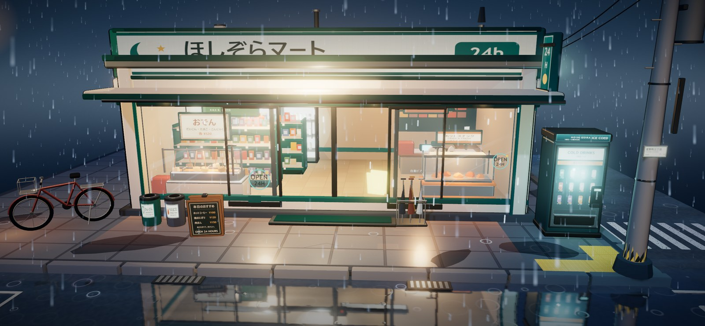
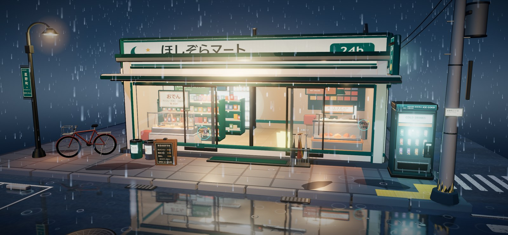
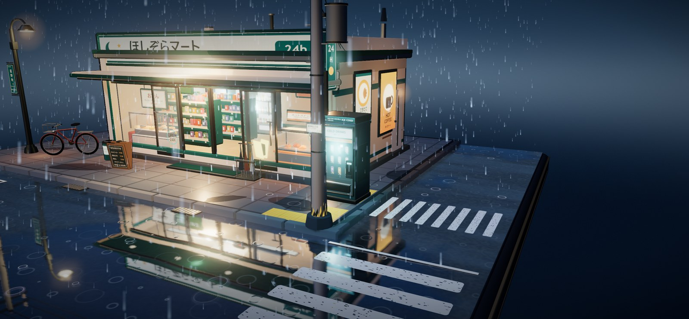

# Route A · 单文件 + CDN + 自写着色器

入口：[`index.html`](index.html)。约 3,000 行，单文件；Three.js 与官方 addons 通过 import map 从 jsDelivr 加载，其余全部内联。


## 技术路线

- **运行时**：Three.js r0.170.0、WebGL 2、原生 ES module，无打包器、无框架。
- **渲染器**：`ACESFilmicToneMapping`、sRGB 输出、`PCFSoftShadowMap`，DPR 上限 1.75。
- **后期**：`EffectComposer` + `RenderPass` + `UnrealBloomPass` + `OutputPass`，两个 composer 目标均开启 4× MSAA，泛光强度 0.34。
- **三渲二**：4 级 `DataTexture` 渐变（52/112/186/255）+ `MeshToonMaterial`。描边不是后期屏幕空间描边，而是给网格挂一层反向外壳 `ShaderMaterial`：`BackSide`、法线经投影矩阵换算到裁剪空间后向外扩张，厚度 `0.00225 × factor`。
- **环境光照**：用一组程序化发光面板搭一个只给 PMREM 用的“灯箱”场景，生成环境贴图；另有独立的程序化夜空穹顶着色器。
- **湿地反射**：`Reflector`（1024×1024）实时重绘镜像场景，替换为自定义片元着色器：fbm 生成水洼/湿润带/微面噪声，时间项扰动反射 UV，按网格单元生成程序化雨环，再叠加 5 抽样模糊与偏蓝染色。反射强度随水洼遮罩在 0.23–0.82 之间变化。
- **雨**：两层 GPU Points，4,200 条远景 + 900 条近景；顶点着色器内循环下落，片元着色器画雨线端部渐隐，`AdditiveBlending`。雨点放在 layer 1，主相机启用 layer 1，而 `Reflector` 的虚拟相机只用默认 layer 0，因此雨不会污染平面倒影。
- **细节动画**：26 条屋檐滴水 + 10 个滴水溅射实例、72 个水洼涟漪实例、关东煮与热食柜的蒸汽点精灵。
- **自动门**：15.5 秒周期；门扇关闭位为 `±0.615`，目标滑程 1.12，完全开启位约 `±1.735`（实拍在门开过程中记录到 `±1.714`）；门传感器辉光与室内溢光同步变化。
- **构图**：`BASE_FOV = 38`，以 1.95 为参考宽高比；窄窗口按水平视野反算垂直 FOV，上限 72°，保证完整正方形底座不被裁切。`OrbitControls` 带阻尼，目标点为 `(-0.45, -0.8, -0.5)`。
- **室内**：关东煮台、热食柜、两组货架、饮料冷柜、收银台均为真实三维陈设，可透过玻璃观看。

## 源码索引

| 模块 | 位置 |
| --- | --- |
| 渲染器与后期 | [`index.html#L56`](index.html#L56) |
| 自适应相机与构图 | [`index.html#L68`](index.html#L68) |
| 4 级卡通渐变 | [`index.html#L151`](index.html#L151) |
| 反向外壳描边材质 | [`index.html#L188`](index.html#L188) |
| PMREM 程序化环境 | [`index.html#L754`](index.html#L754) |
| 夜空穹顶着色器 | [`index.html#L785`](index.html#L785) |
| 湿路面反射着色器 | [`index.html#L914`](index.html#L914) |
| 反射平面 | [`index.html#L1006`](index.html#L1006) |
| 蒸汽点精灵 | [`index.html#L1958`](index.html#L1958) |
| 两层 GPU 雨 | [`index.html#L2694`](index.html#L2694) |
| 72 个涟漪实例 | [`index.html#L2779`](index.html#L2779) |
| 26 条屋檐滴水 | [`index.html#L2823`](index.html#L2823) |
| 自动门周期 | [`index.html#L2898`](index.html#L2898) |
| 招牌微闪 | [`index.html#L2913`](index.html#L2913) |

## 运行

```bash
cd qoder-threejs
python -m http.server 4318
```

打开 `http://127.0.0.1:4318/`。也可以直接双击 `index.html`，但需要联网从 jsDelivr 取 Three.js 与 addons。

操作：左键拖拽旋转，滚轮缩放，右键拖拽平移；触屏为单指旋转、双指缩放与平移。画面内无 UI。

## 验证

- 在 Edge 中实际运行，控制台无错误信息。
- 初始画面完整包含正方形底座与两根电线杆；窄窗口自动扩大垂直 FOV。
- 自动门实拍检查：门开过程中门扇位于 `±1.714`；关闭位 `±0.615`，目标完全开启位约 `±1.735`。
- 雨线、屋檐滴水、水洼涟漪、招牌微闪与湿地倒影逐帧变化。
- 鼠标旋转、滚轮缩放、右键平移均实机检查。

## 细节预览

| 室内陈设 | 自动门开启 |
|:---:|:---:|
|  |  |



## 约束

- 不使用 Blender、预制模型或外部图片/模型/字体。
- 所有几何、材质、灯光与动画都在 JavaScript 中生成；CanvasTexture 仅用于文字、招牌、海报与地面图案。
- Three.js r170 与官方 addons 依 MIT License；CDN 地址写在 import map 中。
